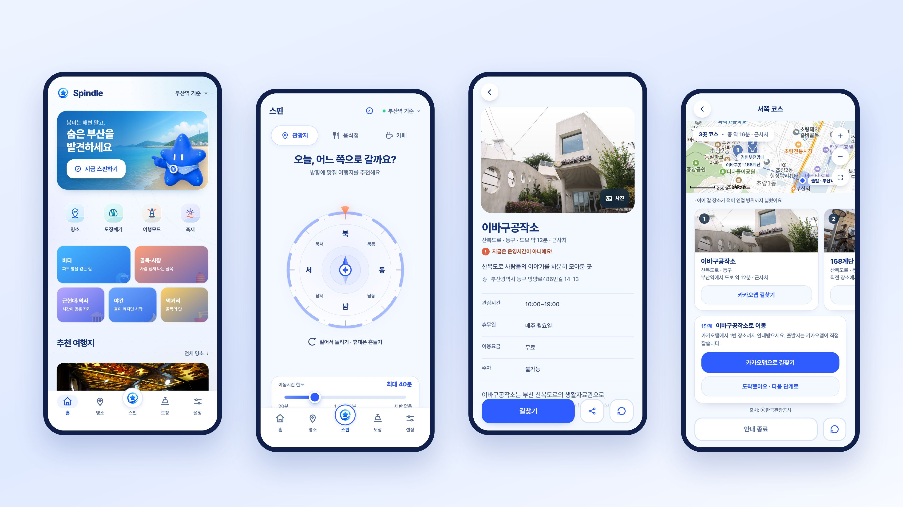
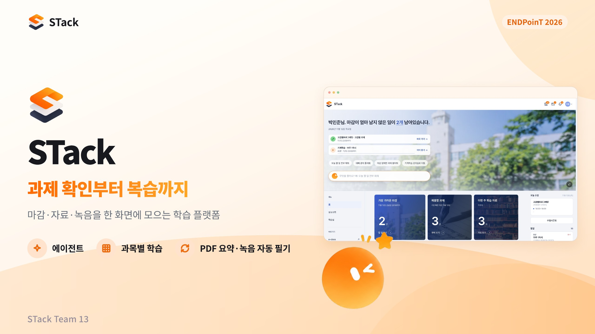

# Simplicity is the Ultimate Sophistication

**복잡함 속 단순함을 추구하는 개발자 이진우입니다.**

기술을 무분별하게 더하기보다, CS 지식과 데이터를 근거로 최적의 추상화를 설계하는 과정을 즐깁니다.

> 서울과학기술대학교 재학 (3학년) · **프론트 / 백엔드 엔지니어**를 목표로 웹 전반에 대한 설계를 공부하고 있으며, 그중 Spring 기본기와 알고리즘을 매일 기록하며 학습 중입니다.

---

##  Daily Practice

매일 세 가지를 **기록으로** 남깁니다. 말보다 흔적으로 증명하는 편을 선호합니다.

| 트랙 | 내용 | 기록 |
|---|---|---|
| **Algorithm** | 하루 2~3문제 + 풀이 회고 | [LeetCode-75](https://github.com/enderpawar/LeetCode-75) |
| **Backend** | Spring 기본기 8주 커리큘럼 | [`[Spring Study]` 시리즈](https://velog.io/@snowmile1224/series/Spring-Boot-Study) |
| **Writing** | 학습 과정을 매일 정리 | [Tech Blog](https://velog.io/@snowmile1224/posts) |

###  최근 작성한 글

<!-- BLOG-POST-LIST:START -->
<!-- BLOG-POST-LIST:END -->

강의 요약이 아니라 **직접 실행해 검증한 기록**을 씁니다.
`문제 → 순진한 시도 → 에러 → 수정 → 개념 정리` 구조로 작성합니다.

예시: 왜 이 구조로 쓰는가

`@Valid` 검증 실패 시 응답을 예측해보고 실제로 찍어봤더니, 예상과 달리 메서드 본문이 아예 실행되지 않았습니다.
`MethodArgumentNotValidException`이 **본문 진입 전에** 던져지기 때문이었습니다.
"동작한다"에서 멈추지 않고 **"왜 이 시점인가"** 까지 확인해야 다음에 응용할 수 있다고 생각합니다.

---

##  Engineering Philosophy

> "내부 로직을 간단하고 직관적으로 만들어 팀과 사용자에게 명료함을 전달"

- **Evidence-based Design** — 취향이 아니라 데이터와 제약 조건(성능·비용·저장 공간)으로 결정합니다.
  → *CS-NextDoor에서 36개 파라미터 조합을 실측 비교해 전처리 파이프라인을 확정했습니다.*
- **Simplicity over Complexity** — 동료가 1분 안에 이해할 수 있는 로직을 우선합니다.
  → *Spindle에서는 핵심 탐색 흐름을 단말에서 처리해, 백엔드 장애에도 스핀 → 추천 → 결과가 이어지도록 설계했습니다.* — [Google Play](https://play.google.com/store/apps/details?id=kr.spindle.app) · [App Store](https://apps.apple.com/kr/app/spindle/id6807658917)
- **Documenting 'Why'** — 결정의 근거를 남깁니다. 학습 과정은 [기술 블로그](https://velog.io/@snowmile1224/posts)에,
  코드 변경의 의도는 PR 본문에 `[Design Decision]` 형식으로 기록합니다.
- **결과를 과장하지 않기** — 측정했다면 표본 수와 한계도 함께 적습니다.

---

##  Tech Stack

현재 **프로젝트에 적용해본 것**과 **학습 중인 것**을 구분해 적었습니다.

| Category | 프로젝트 적용 경험 | 학습 중 (2026 H2) |
|---|---|---|
| **Backend** | Spring Boot (REST API 설계·SSE 스트리밍), Spring Security + JWT, JPA, 트랜잭션, Flyway, MySQL, Node.js | PostgreSQL, Redis |
| **Frontend** | React, TypeScript, Vite, PWA (Service Worker), Electron | Next.js |
| **CV / AI** | OpenCV (Python · WASM), Gemini Vision API | — |
| **Infra** | GitHub Actions, Docker Compose, Cloudflare Pages · Workers, Vercel, Railway | AWS, Terraform |

---

## 📂 Featured Projects

### 1. Spindle | 휴대폰을 돌려 만나는 관광 분산형 탐색 PWA

> "설득이 아니라 게임 구조로 관광 쏠림을 흩어 놓기"

[📂 Repository](https://github.com/enderpawar/Spindle) · [🔗 Live Demo](https://spindle-6vp.pages.dev) · [Google Play](https://play.google.com/store/apps/details?id=kr.spindle.app) · [App Store](https://apps.apple.com/kr/app/spindle/id6807658917) · `React` `TypeScript` `PWA` `Cloudflare Workers` `Spring Boot` `MySQL` `TourAPI`

2026 관광데이터 활용 공모전 출품작 · 1인 개발

- **Problem** — 부산 방문객의 기억이 해운대(58.4%)·광안리(31.7%) 같은 소수 대표지에 쏠려 있습니다. 반경 검색은 바다 건너 직선거리도 "가깝다"고 판단합니다.
- **Solution** — 휴대폰을 돌려 정한 8방위 안에서 방향 일치도 × 접근 가능성 × 운영 상태 × 분산 가중치로 후보를 좁힌 뒤 가중 랜덤으로 추천합니다.
  대상지를 5개 생활권 존으로 나누고 교량·지하철 경유 비용을 반영한 **존-교량 접근성 모델**을 직접 설계했습니다.
- **Privacy by Design** — GPS 좌표·방위각은 어떤 서버로도 보내지 않고 위치 계산을 전부 단말에서 합니다.
  선언에 그치지 않도록 금지 패턴 스캐너가 커밋마다 좌표 전송 코드를 차단합니다.
- **My Part**
  - **UI·프론트엔드 전반 설계 및 구현** — 홈·방향 스핀·추천 결과·코스 안내·지도·도장깨기 화면과 React·TypeScript PWA 구조, 단말 내 추천 계산 및 로컬 우선 동기화 흐름
  - **백엔드 설계 및 구현** — Cloudflare Workers의 TourAPI 프록시와 Spring Boot 서버 구성. 익명 기기 JWT 인증·토큰 회전·기기 이전, 도장 동기화, 운영자 큐레이션·감사 기록, 기간 미션 API 구현
  - **데이터·운영 기반** — JPA·MySQL·Flyway 스키마 관리, 동시성 제어, 공통 오류 응답·요청 추적, Docker Compose·CI·배포 및 백업 스크립트 구성
- **Results**
  - TourAPI 2개 서비스(관광정보 + 집중률 예측) 실시간 연동, 숨은 명소(T3)는 대표 관광지(T1)보다 **3.2배 높은 분산 가중치**
  - 공모전 이후 Spring Boot 백엔드 추가 — 로그인 없는 익명 기기 토큰(JWT), 도장 동기화, 운영자 큐레이션, Flyway·MySQL 8.4·Docker compose 배포
  - 백엔드가 죽어도 핵심 동선(스핀 → 추천 → 결과)은 그대로 동작하는 **로컬 우선** 구조

### 2. STack | 과제 확인부터 복습까지, 한 화면 학습 플랫폼 (팀 프로젝트)

> "마감은 홈에서, 복습은 과목 학습실에서 이어 주기"

[🔗 Live Demo](https://eclass.stack-edu.com) · `🔒 Private (STack-Corp)` · ENDPoinT 2026 · Team 13 · `Spring Boot 4.1` `Java 25` `MySQL 8.4` `Vanilla JS PWA` `AWS` `Terraform`

- **Problem** — 학교 e-Class에서 강의자료 하나를 복습하려면 **클릭 8회, 화면·앱 전환 4회**가 필요했습니다.
  AI로 복습하려면 PDF를 내려받아 다른 앱에 다시 올려야 하고(업로드형 → 흐름이 끊김), 연동형 서비스는 학교 계정을 맡겨야 했습니다(계정 위험). 실제로 2026년 11월 여러 대학이 외부 서비스에 학교 계정을 입력하지 말라고 공지했습니다.
- **Solution** — 원칙 세 가지로 풀었습니다.
  - **한 화면 흐름** — 홈 명령창에 한 줄로 말하면 강의실·자료·과제로 바로 이동하거나 오늘 할 일을 순서대로 실행
  - **과목 안에 묶기** — PDF·녹음은 과목·주차 학습실 안에만 보관해 학교 서버가 불안정해도 복습은 계속
  - **자동 정리** — PDF는 쪽마다 해설이 붙은 요약으로, 녹음은 자동 전사·요약 필기로
- **에이전트 설계** — AI는 정해 둔 **7가지 동작**(이동·고르기·계획·계획 수정·계획 취소·되묻기·없음) 안에서만 고르고,
  서버가 "내 수강 과목인지, 내 할 일인지"를 다시 검증한 뒤 미리 정한 경로로만 이동시킵니다. 틀린 답은 버립니다.
- **My Part**
  - **UI·프론트엔드 전반 설계 및 구현** — 학생·교수 화면의 정보 구조, 공통 UI·내비게이션, 홈·강의실·학습실을 잇는 화면 흐름과 프론트엔드 구조 설계
  - 학생 홈 — 마감 임박 작업 hero, `나의 하루`, 마감순 정렬, 다크 테마
  - 홈 명령창 — 과목 단축어 매칭(음절 건너뛰기·초성·영문 약어, 예: `데베` → 데이터베이스)과 AI 비서·Plan 실행
  - 과목별 PDF 학습실 — 여러 PDF 업로드와 진행 패널, Worker에서 PDF를 파싱해 페이지별 원문·주요 단어 제공
  - **프론트엔드·API 연동** — 학교 계정 로그인, 수강과목 동기화, 오류 응답·업로드 거절 처리
  - **백엔드 초기 구조 설계** — 프로젝트 초기에 백엔드의 기본 구조와 구성 방향 설계에 기여
- **협업** — Jira 이슈 → 브랜치 → PR 리뷰 흐름, 결정은 ADR 38건으로 기록, CI에서 MySQL 마이그레이션·ERD 스냅샷·모듈 의존 규칙까지 검사

### 3. CS-NextDoor | OpenCV × Gemini 기반 PC 진단 가이드

> "텍스트 안내는 있는데, 화면에서 그게 어디인지 모르는 문제"

[📂 Repository](https://github.com/enderpawar/CS-NextDoor) · [🔗 Live Demo](https://nextdoor-cs.vercel.app) · `React PWA` `Spring Boot` `OpenCV.js` `Gemini Vision`

- **Problem** — 비전문가는 "Boot Priority를 바꾸세요"라는 안내를 읽어도 BIOS 화면에서 해당 항목을 찾지 못합니다.
- **Solution** — 역할을 명확히 분리했습니다. **OpenCV는 "어디"(픽셀 좌표), LLM은 "무엇"(의미 판단)** 을 담당합니다.
  화면 정규화(Canny → Hough → Homography → CLAHE) 후, 히스토그램 변화 감지로 **필요한 순간에만** LLM을 호출합니다.
- **My Part**
  - **UI·프론트엔드 전반 설계 및 구현** — React PWA의 진단·카메라·라이브 가이드 화면, OpenCV.js 프레임 처리, SSE 응답 표시와 카메라 위 AR 오버레이를 연결하는 사용자 흐름
  - **백엔드 설계 및 구현** — Spring Boot 진단·가이드 API, Gemini Vision 연동, SSE 기반 단계별 안내, 가이드 세션 생성·종료·만료 처리, 업로드 영상 프레임 추출 API 구현
  - **CV 파이프라인·검증** — BIOS 화면 전처리·변화 감지·품질 필터 설계, Python 실험과 파라미터 비교, 브라우저 OpenCV.js 적용
- **Results**
  - 파라미터 36개 조합 실측 비교(ablation)로 전처리 단계 확정
  - 불필요한 API 호출 제거 → **호출량 83% 감소, 시간당 $1.50 → $0.26**
  - 실촬영 BIOS 22장으로 ROI 검출 검증
- **한계 (명시)** — 품질 필터 ROC는 n=13 소표본이고, ROI 개수는 OCR 정확도의 대리 지표입니다. 결론을 일반화하지 않았습니다.

---

## 🤝 How I Work

- **PR 기반 개발** — 개인 프로젝트도 브랜치 → PR → 리뷰 흐름으로 진행하고, 결정 근거를 본문에 남깁니다.
- **Why-Driven Review** — 코드 리뷰에서 스타일보다 의도와 맥락을 먼저 확인합니다.
- **AI 활용 기준** — 보일러플레이트와 반복 작업은 AI로 줄이고, **아키텍처 결정과 성능 측정은 직접** 합니다.
  CS-NextDoor의 ablation 실험 설계처럼, 판단이 필요한 부분은 근거를 만들어 결정합니다.
